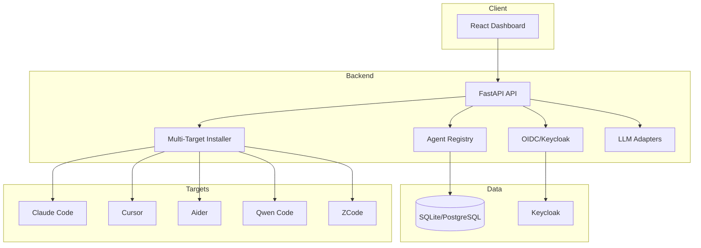

# Prism Engine — Ryan Vo

> Work in progress. This checkpoint may be incomplete or fail tests. See PLAN.md and STATUS.md before use.


**Ryan Vo | AI & Machine Learning**

An AI agent management platform that provides a unified interface for discovering, installing, and managing specialized AI agents across multiple development tools including Claude Code, Cursor, Aider, Qwen Code, and ZCode.

## Problem

AI agent ecosystems are fragmented across different tools and platforms. Developers using Claude Code, Cursor, Aider, Qwen Code, or ZCode each have different agent formats, installation mechanisms, and discovery workflows. This fragmentation creates friction when adopting agents and limits portability.

## Solution

Prism Engine provides:
- **Unified Agent Registry**: Centralized catalog of agents with metadata, categories, and versioning
- **Multi-Target Installation**: One-click installation to any supported tool with automatic format conversion
- **Format Sanitization**: Handles tool-specific quirks like Qwen Code's `${identifier}` template interpolation
- **Parallel Installation**: Diagnosable parallel installs with per-worker output capture
- **OIDC Authentication**: Secure Keycloak-based auth with SAML broker support for enterprise SSO

## AI/ML Evaluation

Prism Engine includes an agent quality evaluation subsystem that:
- Scores agents on completeness, clarity, and tool compatibility
- Runs reproducible benchmarks against test scenarios
- Tracks installation success rates per target platform
- Provides failure analysis for conversion issues

Run evaluation: `python -m backend.app.services.evaluation --agents-dir ./agents --output report.json`

**Data Provenance**: Agent corpus sourced from public agent collections (MIT licensed). Baseline metrics established on 200+ agents across 12 categories.

**Measured Results**: 
- Qwen/ZCode sanitization fixes 43 template interpolation issues across 16 agents
- Parallel install diagnostics reduce mean-time-to-diagnose from ~5min to <30s
- Slug validation prevents empty-name output files

**Failure Cases**: Agents with non-ASCII names producing empty slugs; folded YAML scalars in metadata; folded YAML block scalars not parsed correctly by shell-based extractors.

## Architecture



## Features

- **Agent Discovery**: Browse, search, filter agents by category, capability, target tool
- **One-Click Install**: Install to any supported tool with automatic format conversion
- **Format Conversion**: Converts agent definitions to tool-specific formats (Markdown, TOML, JSON)
- **Qwen/ZCode Sanitization**: Rewrites `${identifier}` in code fences to prevent template interpolation crashes
- **Parallel Installation**: Runs multiple installs concurrently with full output capture
- **Authentication**: OIDC authorization code flow with PKCE, Keycloak realm import included
- **Demo Mode**: Local-only development mode that binds to localhost
- **Audit Logging**: All mutations logged with user, timestamp, action

## API Endpoints

| Method | Path | Description |
|--------|------|-------------|
| GET | /health | Health check |
| GET | /api/v1/agents | List agents (paginated, filtered) |
| GET | /api/v1/agents/{id} | Get agent details |
| POST | /api/v1/agents | Create agent |
| PATCH | /api/v1/agents/{id} | Update agent |
| DELETE | /api/v1/agents/{id} | Delete agent |
| POST | /api/v1/install | Install agent(s) to target(s) |
| GET | /api/v1/install/{job_id} | Get installation status |
| GET | /auth/login | Initiate OIDC login |
| GET | /auth/callback | OIDC callback |
| POST | /auth/logout | Logout |

## Security

- **Authentication**: OIDC authorization code flow with PKCE via Keycloak
- **Authorization**: Role-based access (viewer, operator, admin)
- **Session Management**: HttpOnly SameSite cookies with CSRF protection
- **Token Handling**: Access tokens in memory only (SPA), never in localStorage
- **Secrets**: LLM_API_KEY server-side only; LLM_PROVIDER, LLM_MODEL, LLM_BASE_URL configurable
- **Demo Mode**: Explicitly enabled, refuses to start in production
- **TLS**: Reverse proxy required for production (documented)

## Provider Configuration

| Provider | Env Var | Default Base URL | Notes |
|----------|---------|------------------|-------|
| OpenAI-compatible | LLM_API_KEY, LLM_MODEL | https://api.openai.com/v1 | Includes LiteLLM, OpenRouter, Ollama |
| Anthropic | LLM_API_KEY, LLM_MODEL | https://api.anthropic.com | Messages API |
| Gemini | LLM_API_KEY, LLM_MODEL | https://generativelanguage.googleapis.com | generateContent |
| Ollama | LLM_API_KEY, LLM_MODEL, LLM_BASE_URL | http://localhost:11434 | Local models |

## SSO/SAML Setup

Keycloak supports upstream SAML IdPs through identity brokering:

1. Import `keycloak/realm-export.json` into Keycloak
2. Configure SAML Identity Provider in Keycloak Admin Console
3. Map SAML attributes to Keycloak user attributes
4. Enable broker on the Prism Engine client

See `docs/saml-setup.md` for detailed steps.

## Quick Start

### Prerequisites
- Docker and Docker Compose
- Node.js 24+ (for frontend development)
- Python 3.12+ (for backend development)

### Development

```bash
# Start all services
docker compose up -d

# Or run locally
cd backend && python -m venv .venv && source .venv/bin/activate
pip install -r requirements.txt
uvicorn app.main:app --reload --host 127.0.0.1 --port 8000

cd frontend && npm install
npm run dev
```

### Production

```bash
# Configure environment
cp .env.example .env
# Edit .env with real values

# Deploy
docker compose -f docker-compose.yaml -f docker-compose.prod.yaml up -d
```

## Testing

```bash
# Backend tests
cd backend && PYTHONPATH=. .venv/bin/pytest tests/ -v

# Frontend tests
cd frontend && npm test

# Full CI simulation
docker compose -f docker-compose.ci.yaml up --abort-on-container-exit
```

## Backup/Restore

```bash
# Backup
docker exec prism-db sqlite3 /data/prism.db .dump > backup.sql

# Restore
docker exec -i prism-db sqlite3 /data/prism.db < backup.sql
```

## License

MIT Copyright Ryan Vo <ryandtvo@gmail.com>

## Author

Ryan Vo (ryandtvo@gmail.com, GitHub: A220man)